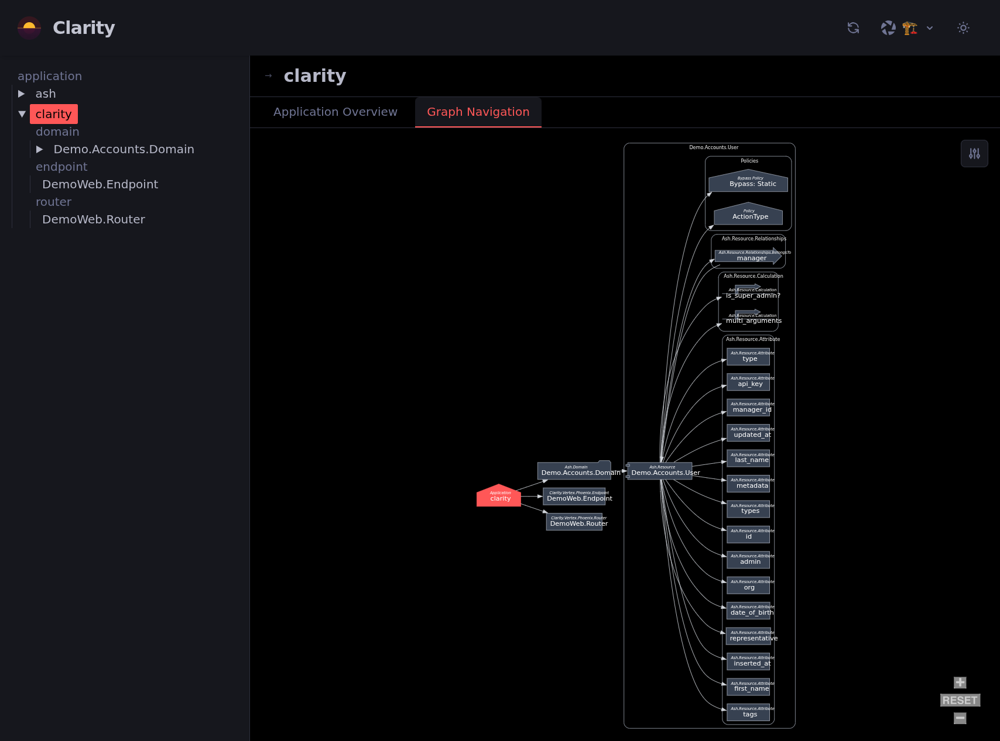
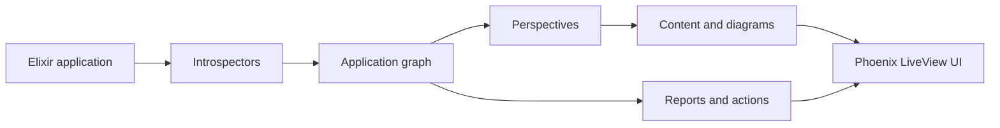

<p align="left">
  
</p>

[](https://github.com/team-alembic/clarity/actions)
[](https://hex.pm/packages/clarity)
[](https://hexdocs.pm/clarity)
[](LICENSE.txt)

<!-- ex_doc_ignore_start -->

# Clarity

<!-- ex_doc_ignore_end -->

**Understand the system you're building.**

Clarity is an interactive architecture explorer for **Elixir, Phoenix, and Ash** applications. It turns your application's compiled structure into a navigable model: see how domains, resources, actions, policies, routes, modules, and dependencies fit together, without maintaining a separate set of diagrams by hand.

Explore a resource, follow a relationship, inspect a policy, trace a Reactor workflow, or review your application's security posture all from a LiveView interface mounted inside your Phoenix application.

> [!WARNING]
> **Alpha software.** Clarity is under active development. APIs, integrations, and the UI may change between releases. Contributions and feedback are welcome.



## Why Clarity?

As an application inevitably grows, answering simple questions gets harder:

- **How does this part of the system fit together?** Follow the application, domain, resource, and relationship graph rather than searching through modules one by one.
- **Who can do what?** Explore Ash policies and inspect action reachability and potential sensitive-field exposure.
- **What breaks or needs attention?** Review dependency advisories, retired versions, outdated packages, and actionable findings.
- **What does the codebase actually mean?** Browse the vocabulary of your Ash domains and identify undocumented entities and fields.
- **How does this workflow execute?** Inspect Reactor flows and, where installed, Ash state-machine diagrams.

Clarity reads the application you have — not a separately maintained architecture document. The result is most useful during development, debugging, onboarding, and design reviews.

## Get started

**Requirements:** Elixir **1.18+**, Phoenix **1.8+**, and LiveView. Ash is optional but it unlocks the power of Ash with richer domain, resource and security views.

### Recommended: Igniter

From your Phoenix project:

```sh
mix igniter.install clarity
```

For Ash projects, install the optional diagram integration too:

```sh
mix igniter.install clarity ash_diagram
```

The Clarity installer adds a route under `/clarity` in the selected Phoenix router, normally guarded by the application's `:dev_routes` configuration. Review the generated changes, then start Phoenix:

```sh
mix phx.server
```

Open **[http://localhost:4000/clarity](http://localhost:4000/clarity)** (or the corresponding port in your application).

> [!TIP]
> **No app to try it in?** Run the [included demo](#try-the-demo) to explore Clarity against sample Ash resources and Phoenix routes.

### Manual installation

Add the dependency to `mix.exs`:

```elixir
defp deps do
  [
    {:clarity, "~> 0.6"},
    {:ash_diagram, "~> 0.2"} # Optional
  ]
end
```

> [!WARNING]
> **Security risk** Clarity introspects your code and system and so we only recommend running this locally in the dev routes. If you want to try this (at your own risk) in a public facing application anyway (a staging server say) then ensure it's behind appropriately authenticated routes, and that you have completely understood the risks.

Run `mix deps.get`, then mount Clarity in your Phoenix router. The example below keeps the explorer behind your application's existing development-routes flag:

```elixir
# lib/my_app_web/router.ex
if Application.compile_env(:my_app, :dev_routes) do
  import Clarity.Router

  scope "/clarity" do
    pipe_through :browser
    clarity "/"
  end
end
```

Replace `:my_app` with your OTP application name. This assumes your router already defines a `:browser` pipeline and your Phoenix endpoint has a LiveView socket at `/live`.

For automatic re-introspection on recompilation, also add `Clarity.CodeReloader` to your Mix project's existing `:listeners` list (the Igniter installer does this for you). If mounting outside the standard LiveView socket path, see [`Clarity.Router`](https://hexdocs.pm/clarity/Clarity.Router.html) for `:live_socket_path` and other options.

**Do not expose Clarity publicly without access controls.** The explorer can reveal application structure, authorization rules, and dependency details. Prefer development-only routing; if you need another environment, protect the route with authentication and appropriate network restrictions. Use the `:on_mount` router option to attach LiveView authorization hooks where necessary.

## Explore your Ash Application

**Clarity is most useful for Ash Applications currently**

Clarity offers several **perspectives** (lenses) over the same discovered application model. Pick the view that matches the question you're answering.

| Perspective       | What it helps you see                                                                                         |
| ----------------- | ------------------------------------------------------------------------------------------------------------- |
| **Architect**     | Domains, resources, actions, attributes, relationships, Phoenix endpoints and routers, and Reactor workflows. |
| **Security**      | Authorization-related elements, Ash policies, and security or dependency-hygiene findings.                    |
| **Documentation** | Module and domain documentation without unrelated implementation detail.                                      |
| **Graph**         | Connections between discovered components; navigate the system by its relationships.                          |
| **Debug**         | A more detailed view for examining introspected elements.                                                     |

Select a component to explore the applicable content panels: resource and action overviews, relationships, calculations, policy information, module documentation, or generated diagrams. What appears depends on the frameworks and extensions installed in your project.

### Investigate security and authorization

The **Security** perspective and **Security posture** report help answer questions that are otherwise awkward to investigate across a large Ash application:

- Which resources have no policy authorizer?
- Which domains check authorization only when requested?
- Which actions appear reachable by anonymous callers or different actor profiles?
- Which sensitive attributes are public without field policies?
- Which policy bypasses deserve a second look?

Clarity derives these findings from Ash resource definitions and policy analysis, and groups issues into **Actions** by severity. Some policy checks depend on runtime context; the report is an analysis aid, **not a proof that every possible request is secure**.

### Inspect your dependency supply chain

The **Supply chain security** report connects the dependency graph with published security advisories and package-version information. It shows installed and latest versions, how dependencies are pulled into the application, and issues such as:

- Known advisories affecting installed versions
- Retired Hex releases
- Dependencies behind their latest release

Findings appear in **Actions**, with suggested `mix deps.update` commands. Advisory matching uses a locally cached copy of the public OSV Hex advisory database; Clarity fetches public advisory data rather than uploading your dependency inventory for matching. Network access is needed to refresh advisory and package data.

### Understand and document your domain

The **Ontology** report creates a browsable glossary from Ash resources: entities, attributes, calculations, aggregates, relationships, types, constraints, and descriptions. It also identifies missing resource and field descriptions, so documentation work can be driven by the definitions already in code.

### Navigate workflows and generated diagrams

With the corresponding packages installed, Clarity can surface:

- **Reactor** workflow and step information
- **Ash state machines** and their transitions
- **AshDiagram** entity-relationship, class, architecture, and policy diagrams, plus policy simulation views

The diagram formats and content available are supplied by each integration. You do not need `ash_diagram` to use Clarity's core navigation, perspectives, or reports.

## How it works

Clarity discovers information from the compiled application, represents it as a connected graph, and renders different views on top of that shared model.



- **Introspectors** discover applications, modules, Ash and Spark constructs, Phoenix components, Reactors, and other supported concepts.
- **Vertices and relationships** make the discovered components navigable rather than leaving each page as an isolated document.
- **Content providers** attach explanations, metadata, visualizations, and diagrams to relevant components.
- **Perspective lensmakers** select which parts of the graph and which content to show for a particular task.
- **Reports and actions** summarize cross-cutting questions and turn findings into prioritised things to investigate or fix.

This separation is intentional: Clarity is a framework for explaining application structure, not a fixed catalog of Ash-specific diagrams.

## Extend Clarity

Applications and libraries can extend Clarity through **introspectors**, **content providers**, **perspective lensmakers**, **status providers**, and **reports**.

### In your application

Register a provider in the host application's configuration:

```elixir
# config/config.exs
config :my_app,
  clarity_content_providers: [MyApp.Clarity.CustomContent]
```

Similarly, use `:clarity_introspectors`, `:clarity_perspective_lensmakers`, `:clarity_status_providers`, or `:clarity_reports` for other types of integrations. Implement the appropriate Clarity behaviour for the provider you register.

### In a reusable library

A library can ship its Clarity integration **alongside the concepts it defines**, register providers in its own application environment, and make Clarity an optional dependency. When a host installs both packages, Clarity discovers the integration without extra host configuration.

See **[Integrating a Library with Clarity](documentation/how_to/integrate-from-a-library.md)** for the complete contract, patterns, and implementation examples.

### Existing integrations

- **[AshDiagram](https://github.com/team-alembic/ash_diagram)** — ER, class, architecture, and policy diagrams and policy-simulation content for Ash.
- **[AshStateMachine](https://hex.pm/packages/ash_state_machine)** — state-machine diagrams for Ash resources using that extension.

## Try the demo

The `demo/` directory is a separate Phoenix application that uses Clarity as a normal dependency, with sample Ash domains, resources, and Phoenix routes.

```sh
git clone https://github.com/team-alembic/clarity.git
cd clarity
(cd demo && mix deps.get)
bin/dev
```

Open **http://localhost:4000** and navigate to **`/clarity`**. The demo uses live reloading for both the host application and Clarity. You can set another port with `PORT=4001 bin/dev`.

## Development and contributions

See the **[development guide](usage-rules/development.md)** for asset builds, tests, and quality checks. From the repository root:

```sh
mix test
mix format
mix check
```

Bug reports, examples, integration ideas, and pull requests are welcome in [GitHub Issues](https://github.com/team-alembic/clarity/issues).

## Documentation and links

- [HexDocs](https://hexdocs.pm/clarity)
- [Package on Hex](https://hex.pm/packages/clarity)
- [Source and issues](https://github.com/team-alembic/clarity)
- [Ash Framework](https://ash-hq.org/)
- [AshDiagram](https://github.com/team-alembic/ash_diagram)

## License

Copyright 2026 Alembic Pty Ltd.

Licensed under the [Apache License, Version 2.0](LICENSE.txt).
